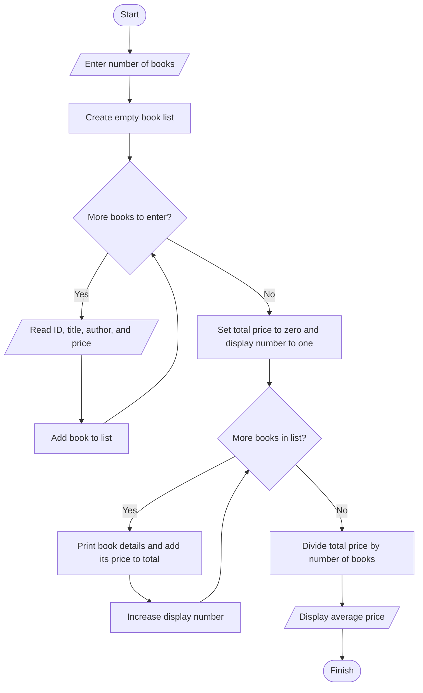
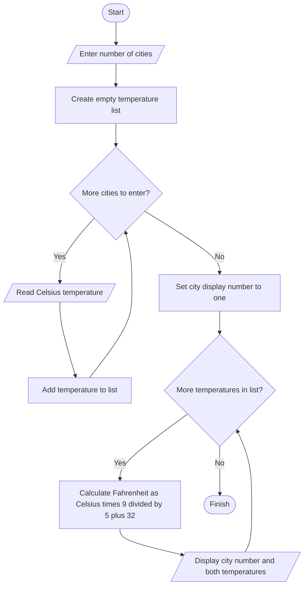
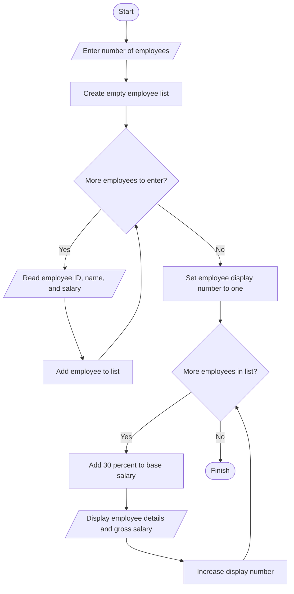
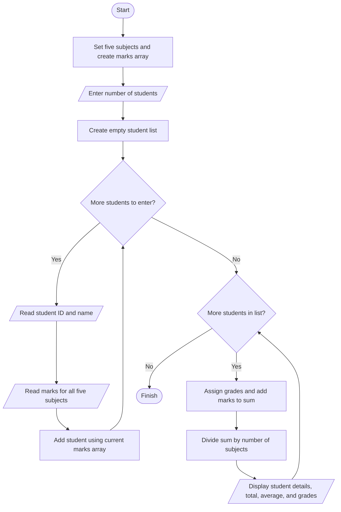
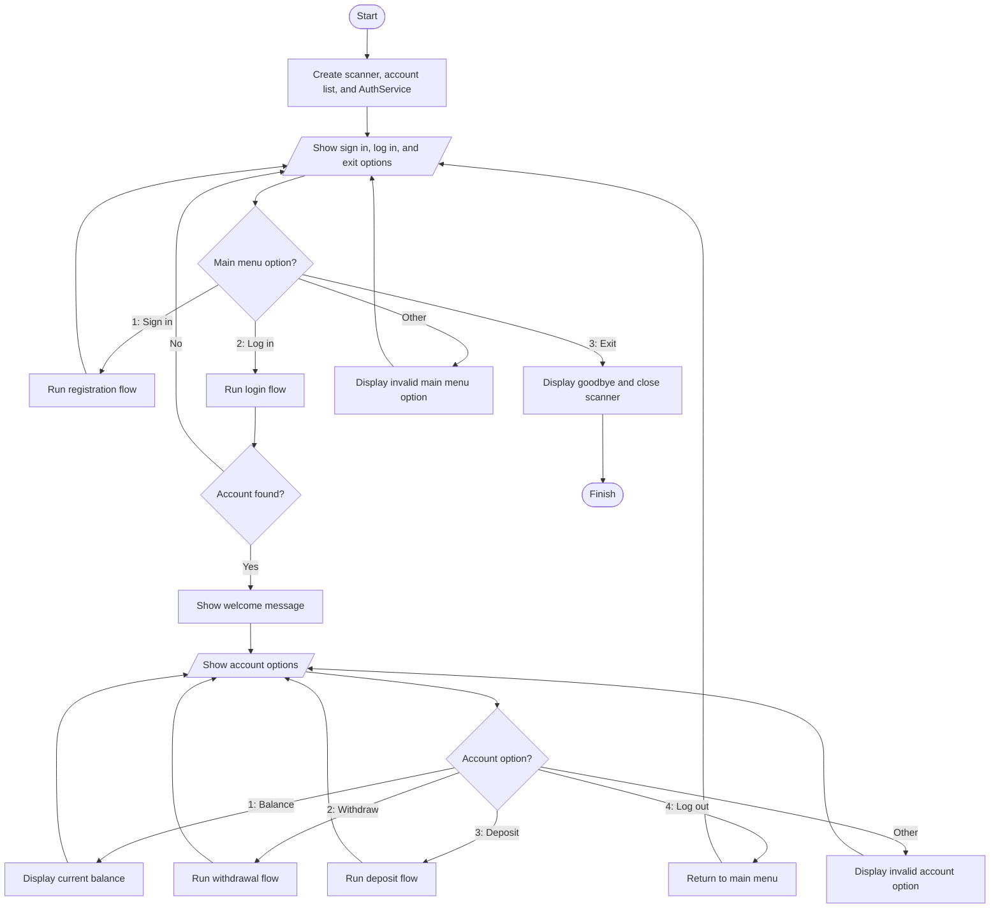
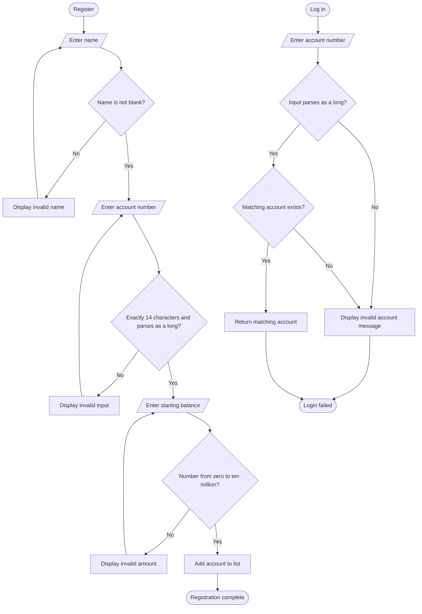
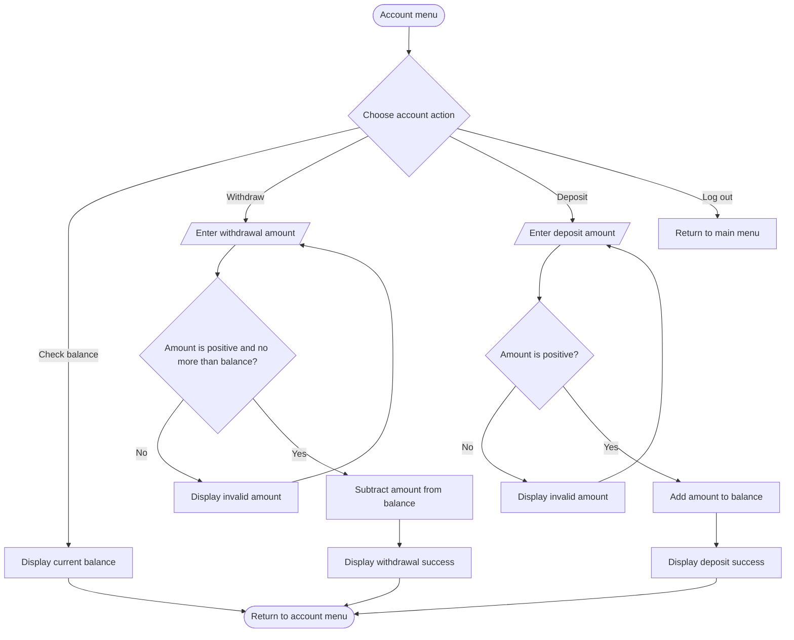

# Lab 03 Report
    Student Name: Song Vansak

    Lecturer Name: BOU Channa

    Major: Software Engineering (SE)

    Date: 30/10/2026
##

This report presents the five Java exercises with explanations, flowcharts, pseudocode, full source listings, and representative console output. The Java listings are copied from the current project files.

## Exercise1.java — Book List and Average Price

### Explanation
This program collects book IDs, titles, authors, and prices. It stores the books, prints their details, and calculates the average price.

### Flowchart



### Pseudocode

```text
START
    Ask for number of books
    Create an empty list of books

    REPEAT once per book
        Read book ID
        Read book title
        Read author name
        Read price
        Create a book and add it to the list
    END REPEAT

    totalPrice = 0
    displayNumber = 1
    FOR each book in the list
        Print displayNumber and the book's details
        totalPrice = totalPrice + book price
        displayNumber = displayNumber + 1
    END FOR

    averagePrice = totalPrice / number of books
    Print averagePrice
END
```

```java


import java.util.ArrayList;
import java.util.Scanner;


public class Exercise1 {
    public static class Book {
        int id;
        String title;
        String author;
        double price;

        Book(int id, String title, String author, double price) {
            this.id = id;
            this.title = title;
            this.author = author;
            this.price = price;
        }

        void Print() {
            System.out.printf("- ID: %d\n- Title: %s\n- Author: %s\n- Price: %f", this.id, this.title, this.author, this.price);
        }
    }
    public static void main(String[] args) throws Exception { 
        ArrayList <Book> books = new ArrayList<>();
        Scanner input = new Scanner(System.in);
        System.out.print("Please Enter Number of Books: ");
        int num = input.nextInt();
        System.out.println("=".repeat(30));
        for(int i = 0; i < num; i ++) {
            System.out.println("+ Book " + (i + 1) + ":");
            System.out.print("Please Enter Book ID: ");
            int id = input.nextInt();
            input.nextLine();
            System.out.print("Please Enter Book Title: ");
            String title = input.nextLine();
            System.out.print("Please Enter Author Name: ");
            String author = input.nextLine();
            System.out.print("Please Enter Book Price: ");
            double price = input.nextDouble();
            books.add(new Book(id, title, author, price));
            input.nextLine();
        }
        input.close();
        System.out.println("=".repeat(30));

        int i = 1;
        double avg = 0;
        System.out.println("=".repeat(30));
        for(Book book : books) {
            System.out.printf("Book %d:\n", i);
            book.Print();
            System.out.println();
            avg += book.price;
            i ++;
        }
        System.out.println("=".repeat(30));
        System.out.printf("+ Average Price: %f", (avg / books.size()));
        System.out.println("\n=".repeat(30));
    }
}
```

### Representative run

Sample input: Two books.

```text
Please Enter Number of Books: 2
==============================
+ Book 1:
Please Enter Book ID: 123
Please Enter Book Title: title 1
Please Enter Author Name: Sak
Please Enter Book Price: 10
+ Book 2:
Please Enter Book ID: 456
Please Enter Book Title: title 2
Please Enter Author Name: Sith
Please Enter Book Price: 67
==============================
==============================
Book 1:
- ID: 123
- Title: title 1
- Author: Sak
- Price: 10.000000
Book 2:
- ID: 456
- Title: title 2
- Author: Sith
- Price: 67.000000
==============================
+ Average Price: 38.500000
==============================
```

## Exercise2.java — Celsius to Fahrenheit

### Explanation
This program collects Celsius temperatures for a set of cities, converts each value to Fahrenheit, and displays both temperatures.

### Flowchart



### Pseudocode

```text
START
    Ask for number of cities
    Create an empty list of temperatures

    REPEAT once per city
        Read Celsius temperature
        Create a temperature record and add it to the list
    END REPEAT

    cityNumber = 1
    FOR each temperature in the list
        Fahrenheit = Celsius * 9 / 5 + 32
        Print cityNumber, Celsius, and Fahrenheit
    END FOR
END
```

```java

import java.util.ArrayList;
import java.util.Scanner;

public class Exercise2 {
    public static class Temperature {
        double F;
        double C;

        Temperature(double C) {
            this.C = C;
        }

        void convert() {
            F = (C * 9) / 5 + 32;
        }
    }
    public static void main(String[] args) {
        ArrayList <Temperature> temps = new ArrayList<>();

        Scanner input = new Scanner(System.in);
        System.out.print("Enter Number of Cities: ");
        int num = input.nextInt();
        for (int i = 0; i < num; i ++) {
            System.out.print("+ City " + (i + 1) + " Temperature in Celsius: ");
            double temp = input.nextDouble();
            temps.add(new Temperature(temp));
        }
        int i = 1;
        System.out.println("=".repeat(30));
        for (Temperature temp : temps) {
            temp.convert();
            System.out.println("+ City " + i + ": ");
            System.out.println("Celsius: " + temp.C);
            System.out.println("Fahrenheit: " + temp.F + "\n");
        }
        System.out.println("=".repeat(30));
    }
}
```

### Representative run

Sample input: Two city temperatures.

```text
Enter Number of Cities: 2
+ City 1 Temperature in Celsius: 36
+ City 2 Temperature in Celsius: 67
==============================
+ City 1: 
Celsius: 36.0
Fahrenheit: 96.8

+ City 2: 
Celsius: 67.0
Fahrenheit: 152.6
==============================
```

## Exercise3.java — Employee Gross Salary

### Explanation
This program collects employee IDs, names, and salaries. It calculates gross salary by adding 30 percent to each base salary.

### Flowchart



### Pseudocode

```text
START
    Ask for number of employees
    Create an empty employee list

    REPEAT once per employee
        Read employee ID
        Read employee name
        Read salary
        Create employee and add it to the list
    END REPEAT

    employeeNumber = 1
    FOR each employee in the list
        grossSalary = salary + 0.30 * salary
        Print employeeNumber, name, ID, salary, and grossSalary
        employeeNumber = employeeNumber + 1
    END FOR
END
```

```java


import java.util.ArrayList;
import java.util.Scanner;

public class Exercise3 {
    public static class Employee {
        int id;
        String name;
        double salary;
        double gross_salary = 0;

        Employee(int id, String name, double salary) {
            this.id = id;
            this.name = name;
            this.salary = salary;
        }
        void calculate() {
            gross_salary = salary + 0.3 * salary;
        }
    }

    public static void main(String[] args) {
        ArrayList <Employee> employees = new ArrayList<>();

        Scanner input = new Scanner(System.in);
        System.out.print("Please Enter Number of Employees: ");
        int num = input.nextInt();
        System.out.println("=".repeat(30));
        for(int i = 0; i < num; i ++) {
            System.out.println("+ Employee " + (i + 1) + ":");
            System.out.print("Please Enter Employee ID: ");
            int id = input.nextInt();
            input.nextLine();
            System.out.print("Please Enter Employee Name: ");
            String name = input.nextLine();
            System.out.print("Please Enter Employee Salary: ");
            double salary = input.nextDouble();
            employees.add(new Employee(id, name, salary));
        }
        System.out.println("=".repeat(30));
        input.close();
        int i = 1;
        System.out.println("=".repeat(30));
        for(Employee employee : employees) {
            employee.calculate();
            System.out.printf("+ Employee %s: \n- Name: %s\n- ID: %d\nSalary: %f\n- Gross Salary: %f", i, employee.name, employee.id, employee.salary, employee.gross_salary);
            System.out.println();
            i ++;
        }
        System.out.println("=".repeat(30));
    }
}
```

### Representative run

Sample input: Two employees.

```text
Please Enter Number of Employees: 2
==============================
+ Employee 1:
Please Enter Employee ID: 123
Please Enter Employee Name: Bosba
Please Enter Employee Salary: 6767
+ Employee 2:
Please Enter Employee ID: 456
Please Enter Employee Name: Socheat
Please Enter Employee Salary: 1234
==============================
==============================
+ Employee 1: 
- Name: Bosba
- ID: 123
Salary: 6767.000000
- Gross Salary: 8797.100000
+ Employee 2: 
- Name: Socheat
- ID: 456
Salary: 1234.000000
- Gross Salary: 1604.200000
==============================
```

## Exercise4.java — Student Marks and Grades

### Explanation
This program collects each student's marks in five subjects, assigns a letter grade to every mark, and displays a total and average.

### Flowchart



### Pseudocode

```text
START
    subjects = Mathematics, Physics, Chemistry, Programming, History
    Create one marks array with one position per subject
    Ask for number of students
    Create an empty student list

    REPEAT once per student
        Read student ID and name
        FOR each subject position
            Read mark into the marks array
        END FOR
        Create student with ID, name, and marks array
        Add student to the list
    END REPEAT

    reportNumber = 1
    FOR each student in the list
        sum = 0
        FOR each mark
            IF mark >= 90, grade = A
            ELSE IF mark >= 75, grade = B
            ELSE IF mark >= 50, grade = C
            ELSE, grade = F
            Add mark to sum
        END FOR
        average = sum / number of subjects
        Print reportNumber, student ID, name, total, average, and each mark with its grade
    END FOR
END
```

```java


import java.util.ArrayList;
import java.util.Scanner;

// import com.google.gson.Gson;
// import com.google.gson.GsonBuilder;

public class Exercise4 {
    public static class Student {
        int id;
        String name;
        double[] marks;
        char[] grades;
        double sum = 0, avg;

        Student(int id, String name, double[] marks) {
            this.id = id;
            this.name = name;
            this.marks = marks;
            grades = new char[marks.length];
        }

        void grade() {
            for(int i = 0; i < grades.length; i ++) {
                double mark = marks[i];
                if (mark >= 90) {
                    grades[i] = 'A';
                } else if (mark >= 75) {
                    grades[i] = 'B';
                } else if (mark >= 50) {
                    grades[i] = 'C';
                } else if (mark < 50) {
                    grades[i] = 'F';
                }
                sum += mark;
            }
            avg = sum / marks.length;
        }
    }
    public static void main(String[] args) {
        // Gson gson = new GsonBuilder().setPrettyPrinting().create();

        ArrayList <Student> students = new ArrayList<>();

        String[] subjects = {"Mathematics", "Physics", "Chemistry", "Programming", "History"};
        double[] marks = new double[subjects.length];

        Scanner input = new Scanner(System.in);
        System.out.print("Please enter number of Students: ");
        int num = input.nextInt();
        System.out.println("=".repeat(30));
        for (int i = 0; i < num; i ++) {
            System.out.println("+ Student " + (i + 1) + ":");
            System.out.print("Please enter student ID: ");
            int id = input.nextInt();
            System.out.print("Please enter student Name: ");
            input.nextLine();
            String name = input.nextLine();
            for (int j = 0; j < subjects.length; j ++) {
                System.out.print(" > Enter " + subjects[j] + " mark: ");
                marks[j] = input.nextDouble();
            }
            students.add(new Student(id, name, marks));
        }
        System.out.println("=".repeat(30));
        System.out.println("=".repeat(30));
        int i = 1;
        for (Student student : students) {
            student.grade();
            System.out.println("+ Student " + (i + 1) + ":");
            System.out.println(" - ID: " + student.id);
            System.out.println(" - Name: " + student.name);
            System.out.println(" - Total Mark: " + student.sum);
            System.out.println(" - Average: " + student.avg);
            for (int j = 0; j < subjects.length; j ++) {
                System.out.println("  > " + subjects[j] + ":\n   - Mark: " + student.marks[j] + "\n   - Grade: " + student.grades[j]);
            }
        }
        // String json = gson.toJson(students);
        System.out.println("=".repeat(30));
        // System.out.println(gson.toJson(json));
    }
}
```

### Representative run

Sample input: One student with marks 90, 80, 70, 60, and 40.

```text 
Please enter number of Students: 2
==============================
+ Student 1:
Please enter student ID: 123
Please enter student Name: Sak
 > Enter Mathematics mark: 20
 > Enter Physics mark: 40
 > Enter Chemistry mark: 40
 > Enter Programming mark: 60
 > Enter History mark: 10
+ Student 2:
Please enter student ID: 456
Please enter student Name: Sith
 > Enter Mathematics mark: 60
 > Enter Physics mark: 10
 > Enter Chemistry mark: 10
 > Enter Programming mark: 70
 > Enter History mark: 70
==============================
==============================
+ Student 2:
 - ID: 123
 - Name: Sak
 - Total Mark: 220.0
 - Average: 44.0
  > Mathematics:
   - Mark: 60.0
   - Grade: C
  > Physics:
   - Mark: 10.0
   - Grade: F
  > Chemistry:
   - Mark: 10.0
   - Grade: F
  > Programming:
   - Mark: 70.0
   - Grade: C
  > History:
   - Mark: 70.0
   - Grade: C
+ Student 2:
 - ID: 456
 - Name: Sith
 - Total Mark: 220.0
 - Average: 44.0
  > Mathematics:
   - Mark: 60.0
   - Grade: C
  > Physics:
   - Mark: 10.0
   - Grade: F
  > Chemistry:
   - Mark: 10.0
   - Grade: F
  > Programming:
   - Mark: 70.0
   - Grade: C
  > History:
   - Mark: 70.0
   - Grade: C
==============================
```

## Exercise5.java — Account Registration and Banking Menu

### Explanation
This program keeps account records in memory, supports registration and login, and provides balance, deposit, withdrawal, and logout actions.

### Main menu flowchart



### Registration and login flowchart



### Account actions flowchart



### Pseudocode

```text
CLASS Account
    Store name, account number, and balance

    DEPOSIT(amount)
        IF amount > 0
            balance = balance + amount
            RETURN true
        RETURN false
    END DEPOSIT

    WITHDRAW(amount)
        IF amount > 0 AND amount <= balance
            balance = balance - amount
            RETURN true
        RETURN false
    END WITHDRAW
END CLASS

CLASS AuthService
    Store account list and scanner

    AUTHENTICATE(accountNumber)
        Find account with matching number
        Return that account, or null if none exists
    END AUTHENTICATE

    REGISTER()
        Read name until it is not blank
        Read account number until it has exactly 14 characters and parses as a long
        Read starting balance until it parses as a number from 0 to 10,000,000
        Add a new account to the account list
        Show message asking the user to log in
    END REGISTER

    LOG_IN()
        Read account number
        IF it parses as a long and a matching account exists
            Return the matching account
        ELSE
            Show invalid account message
            Return null
    END LOG_IN
END CLASS

MAIN
    Create scanner, empty account list, and AuthService
    REPEAT until the user chooses Exit
        Show main menu and read option

        IF option is Sign in
            Call REGISTER
        ELSE IF option is Log in
            account = LOG_IN
            IF account is not null
                Show welcome message
                REPEAT until user logs out
                    Show account menu and read option
                    IF option is Check Balance
                        Display account balance
                    ELSE IF option is Withdraw
                        REPEAT
                            Read amount
                            Try WITHDRAW(amount)
                            If successful, show success message
                        UNTIL withdrawal succeeds
                    ELSE IF option is Deposit
                        REPEAT
                            Read amount
                            Try DEPOSIT(amount)
                            If successful, show success message
                        UNTIL deposit succeeds
                    ELSE IF option is Log out
                        Leave account menu
                    ELSE
                        Show invalid option
                    END IF
                END REPEAT
            END IF
        ELSE IF option is Exit
            Show goodbye message
            Close scanner
            Stop program
        ELSE
            Show invalid option
        END IF
    END REPEAT
END MAIN
```

```java


import java.util.ArrayList;
import java.util.Scanner;

public class Exercise5 {
	public static class Account { // This is a individual user account 'Class'.
	    private String name;
	    private long account_num;
	    private double balance;

	    public Account(String name, long account_num, double balance) {
	        this.name = name;
	        this.account_num = account_num;
	        this.balance = balance;
	    }

	    public boolean Deposit(double amount) {
	        if (amount > 0) {
	            balance += amount;
	            return true;
	        }
	        return false;
	    }

	    public boolean Withdraw(double amount) {
	        if (amount > 0 && amount <= balance) {
	            balance -= amount;
	            return true;
	        }
	        return false;
	    }

	    public long getAccountNumber() {
	        return account_num;
	    }

	    public String getName() {
	        return name;
	    }

	    public double getBalance() {
	        return balance;
	    }
	}
	
	public static class AuthService { // This is AUthentication Service.
	    private ArrayList <Account> accounts = new ArrayList<>();
	    private Scanner input;
	    public AuthService(ArrayList <Account> accounts, Scanner input) {
	        this.accounts = accounts;
	        this.input = input;
	    }

		public Account Authenticate(long account_num) {
	        for (Account account : accounts) {
	            if (account.getAccountNumber() == account_num) {
	                return account;
	            }
	        }
	        return null;
	    }
		
	    public void Register(ArrayList <Account> account) {
	        clearScreen();
	        String name;
	        String str;
	        Long account_num;
	        double balance;
	        
	        input.nextLine();
	        while (true) {
	        	System.out.print("Enter your name: ");
	        	name = input.nextLine();
	        	if (name.trim().isEmpty()) {
	        		clearScreen();
	        		System.out.println("Invalid Name!");
	        		System.out.println("=".repeat(30));
	        	} else break;
	        }
	        
	        while (true) {
	        	System.out.print("Enter your Account Number: ");
	        	str = input.nextLine();
	        	
	        	if (str.length() == 14 && LongParse(str)) {
	        		account_num = Long.parseLong(str);
	        		break;
	        	} else {
	        		clearScreen();
	        		System.out.println("Invalid Input!");
	        		System.out.println("=".repeat(30));
	        	}
	        }
	        	
	        while (true) {
	        	System.out.print("Enter your Balance: ");
	        	str = input.nextLine();
	        	if (DoubleParse(str)) {
	        		balance = Double.parseDouble(str);
	        		if (balance >= 0 && balance <= 10e6) break;
	        		else {
	        			clearScreen();
		        		System.out.println("Invlaid Amount!");
		        		System.out.println("=".repeat(30));
	        		}
	        	}
	        	else {
	        		clearScreen();
	        		System.out.println("Invlaid Input!");
	        		System.out.println("=".repeat(30));
	        	}
	        }
	        	
        	account.add(new Account(name, account_num, balance));
	        clearScreen();
	        System.out.println("Please log in to your account!");
	        System.out.println("=".repeat(30));
	    }
	    
	    public Account LogIn(ArrayList <Account> accounts) {
	        clearScreen();
	        input.nextLine();
	        String str;
	        long account_number;	
	        
        	System.out.print("Enter your Account Number: ");
        	str = input.nextLine();
        	if (LongParse(str)) {	        		
        		account_number = Long.parseLong(str);
        		for (Account account : accounts) {
        			if (account.getAccountNumber() == account_number) return Authenticate(account.getAccountNumber());
        		}
        	}
        	clearScreen();
        	System.out.println("Sorry! Invalid account number or input!");
        	System.out.println("=".repeat(30));
	        return null;
	    }
	    
	    public boolean LongParse(String str) {
	    	try {Long.parseLong(str);} 
	    	catch (Exception e) {return false;}
	    	return true;
	    }
	    
	    public boolean DoubleParse(String str) {
	    	try {Double.parseDouble(str);} 
	    	catch (Exception e) {return false;}
	    	return true;
	    }
	}

    public static void clearScreen() {
        System.out.println("\033[H\033[2J");
    }

    public static void main(String[] args) { // Main class, where all the code run.

    	Scanner input = new Scanner(System.in);
        ArrayList <Account> accounts = new ArrayList<>();
        Account current_acc;
        AuthService authService = new AuthService(accounts, input);

        while (true) { 
            System.out.println("Enter an option below: ");
            System.out.println("1 - Sign in");
            System.out.println("2 - Log in");
            System.out.println("3 - Exit");
            System.out.print("Your Option: ");
            int option = input.nextInt();
            switch (option) {
                case 1 -> authService.Register(accounts);
                case 2 -> {
                    current_acc = authService.LogIn(accounts);
                    if (current_acc != null) {
                        input.nextLine();
                        clearScreen();
                        System.out.println("Welcome! " + current_acc.getName());
                        System.out.println("=".repeat(30));
                        boolean running = true;
                        while (running) { 
                            System.out.println("Enter an Option below: ");
                            System.out.println("1 - Check Balance");
                            System.out.println("2 - Withdraw Money");
                            System.out.println("3 - Deposit Money");
                            System.out.println("4 - Log out");
                            System.out.print("Your Option: ");
                            option = input.nextInt();
                            switch (option) {
                                case 1 -> {
                                    clearScreen();
                                    System.out.println("=".repeat(30));
                                    System.out.println("Your Current Balance: " + current_acc.getBalance());
                                    System.out.println("=".repeat(30));
                                    break;
                                }
                                case 2 -> {
                                    clearScreen();
                                    while (true) { 
                                        System.out.println("=".repeat(30));
                                        System.out.println("Your Balance: " + current_acc.getBalance());
                                        System.out.print("Enter Amount to Withdraw: ");
                                        double amount = input.nextDouble();
                                        if (current_acc.Withdraw(amount)) {
                                            clearScreen();
                                            System.out.println("Withdraw Successful!!");
                                            break;
                                        }
                                        else {
                                            clearScreen();
                                            System.out.println("Invalid Amount!");
                                        }
                                    }
                                    System.out.println("=".repeat(30));
                                    break;
                                }
                                case 3 -> {
                                    clearScreen();
                                    while (true) {
                                    	double amount;
                                        System.out.println("=".repeat(30));
                                        System.out.println("Your Balance: " + current_acc.getBalance());
                                        System.out.print("Enter Amount to Deposit: ");
                                        amount = input.nextDouble();
                                        if (current_acc.Deposit(amount)) {
                                            clearScreen();
                                            System.out.println("Deposit Successful!!");
                                            System.out.println("=".repeat(30));
                                            break;
                                        }
                                        else {
                                            clearScreen();
                                            System.out.println("Invalid Amount!!");
                                        } 
                                    }
                                }
                                case 4 -> {
                                    clearScreen();
                                    System.out.println("Logged out!!");
                                    System.out.println("=".repeat(30));
                                    input.nextLine();
                                    running = false;
                                    break;
                                }
                                default -> {
                                    clearScreen();
                                    System.out.println("Invalid Option!!");
                                    System.out.println("=".repeat(30));
                                }
                            }
                        }
                    }
                    break;
                }
                case 3 -> {
                    clearScreen();
                    System.out.println("Goodbye!!");
                    input.close();
                    return;
                }
                default -> {
                    clearScreen();
                    System.out.println("Invalid Option!!");
                    System.out.println("=".repeat(30));
                }
            }
        }
    }
}
```

### Representative run

Sample input: Register two account, log in, check its balance, deposit, withdraw, log out, and exit.

```text
Enter an option below: 
1 - Sign in
2 - Log in
3 - Exit
Your Option: 1

Enter your name: Sak
Enter your Account Number: 11111111111111
Enter your Balance: 1000

Please log in to your account!
==============================
Enter an option below: 
1 - Sign in
2 - Log in
3 - Exit
Your Option: 2

Enter your Account Number: 11111111111111
Welcome! Sak
==============================
Enter an Option below: 
1 - Check Balance
2 - Withdraw Money
3 - Deposit Money
4 - Log out
Your Option: 1

==============================
Your Current Balance: 1000.0
==============================
Enter an Option below: 
1 - Check Balance
2 - Withdraw Money
3 - Deposit Money
4 - Log out
Your Option: 2

==============================
Your Balance: 1000.0
Enter Amount to Withdraw: 100

Withdraw Successful!!
==============================
Enter an Option below: 
1 - Check Balance
2 - Withdraw Money
3 - Deposit Money
4 - Log out
Your Option: 3

==============================
Your Balance: 900.0
Enter Amount to Deposit: 200

Deposit Successful!!
==============================
Enter an Option below: 
1 - Check Balance
2 - Withdraw Money
3 - Deposit Money
4 - Log out
Your Option: 4

Logged out!!
==============================
Enter an option below: 
1 - Sign in
2 - Log in
3 - Exit
Your Option: 1

Enter your name: Sith
Enter your Account Number: 22222222222222
Enter your Balance: 2000

Please log in to your account!
==============================
Enter an option below: 
1 - Sign in
2 - Log in
3 - Exit
Your Option: 2

Enter your Account Number: 22222222222222
Welcome! Sith
==============================
Enter an Option below: 
1 - Check Balance
2 - Withdraw Money
3 - Deposit Money
4 - Log out
Your Option: 4

Logged out!!
==============================
Enter an option below: 
1 - Sign in
2 - Log in
3 - Exit
Your Option: 3

Logged out!!
==============================
Enter an option below: 
1 - Sign in
2 - Log in
3 - Exit
Your Option: 
Goodbye!!
```
